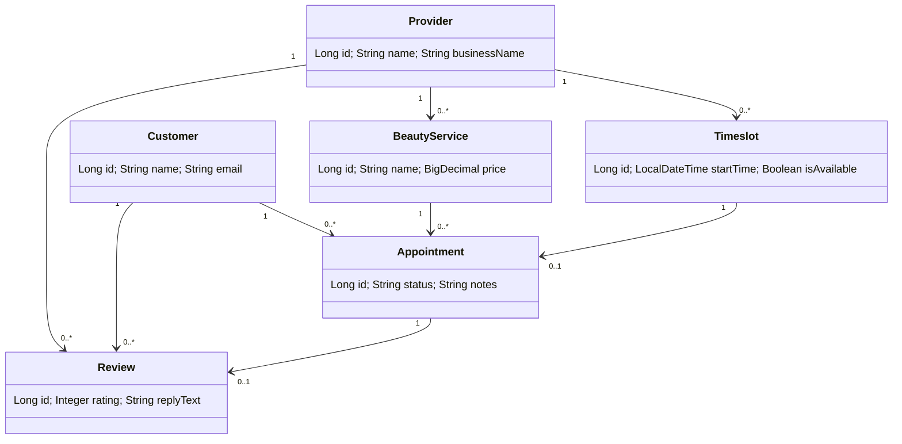

# SalonSearcher Backend API

**Live URL:** https://f26-team25.onrender.com

Note: the free Render instance sleeps when idle, so the first request can take up to a minute.

## UML class diagram



## Endpoints

| Method | Path | Description | Success | Implemented by |
|---|---|---|---|---|
| POST | `/api/providers` | Create provider profile | 201 | jnolte |
| GET | `/api/providers` | List providers | 200 | jnolte |
| GET | `/api/providers/{id}` | View one provider | 200 | jnolte |
| PUT | `/api/providers/{id}` | Modify provider profile | 200 | jnolte |
| DELETE | `/api/providers/{id}` | Delete provider (409 if it has appointments) | 204 | jnolte |
| GET | `/api/providers/{id}/statistics` | View customer statistics | 200 | jnolte |
| GET | `/api/providers/{providerId}/reviews` | View reviews of a provider | 200 | jnolte |
| POST | `/api/providers/{providerId}/reviews/{reviewId}/replies` | Reply to a review | 200 | jnolte |

### Beauty service (use cases: create a service, view available services)

| Method | Path | Description | Success | Implemented by |
|---|---|---|---|---|
| POST | `/api/services` | Create a service for a provider | 201 | jnolte |
| GET | `/api/services` | View available services (optional `?providerId=1`) | 200 | jnolte |
| GET | `/api/services/{id}` | View one service | 200 | jnolte |
| PUT | `/api/services/{id}` | Modify a service | 200 | jnolte |
| DELETE | `/api/services/{id}` | Delete a service (409 if it has appointments) | 204 | jnolte |

### Appointment (use cases: book an appointment, manage appointments)

| Method | Path | Description | Success | Implemented by |
|---|---|---|---|---|
| POST | `/api/customers/{customerId}/appointments` | Book a service in an available timeslot | 201 | jnolte (booking logic), Alexis (route) |
| GET | `/api/appointments` | List appointments (optional `?providerId=1&status=BOOKED`) | 200 | jnolte |
| GET | `/api/appointments/{id}` | View one appointment | 200 | jnolte |
| PUT | `/api/appointments/{id}` | Update status, notes, level or location (status `CANCELLED` frees the timeslot) | 200 | jnolte |
| DELETE | `/api/appointments/{id}` | Delete an appointment and free its timeslot | 204 | jnolte |

### Customer, timeslot and review endpoints

Lexi add your endpoints and user-story mappings here.

## Example request bodies

**POST /api/providers**
```json
{
  "name": "Glow Studio",
  "email": "glow@example.com",
  "password": "secret123",
  "phoneNumber": "555-1234",
  "businessName": "Glow Studio",
  "address": "1 Main St",
  "bio": "Hair and nails"
}
```

**PUT /api/providers/{id}**
```json
{ "businessName": "Glow Studio Deluxe", "bio": "Hair, nails and lashes" }
```

**POST /api/services**
```json
{
  "name": "Haircut",
  "description": "Cut and style",
  "price": 45.00,
  "durationMinutes": 60,
  "providerId": 1
}
```

**PUT /api/services/{id}**
```json
{
  "name": "Haircut Deluxe",
  "description": "Cut, wash and style",
  "price": 55.00,
  "durationMinutes": 75
}
```

**POST /api/customers/{customerId}/appointments**
```json
{ "beautyServiceId": 1, "timeslotId": 1, "notes": "First visit" }
```

**PUT /api/appointments/{id}**
```json
{ "status": "COMPLETED" }
```

**POST /api/providers/{providerId}/reviews/{reviewId}/replies**
```json
{ "replyText": "Thank you, see you again!" }
```

## Notes

- Passwords are stored as plain text and are never returned in responses.
- A timeslot can be booked once; booking an unavailable timeslot returns 409.
- Data persists in Neon PostgreSQL.
(`ddl-auto=update`).
